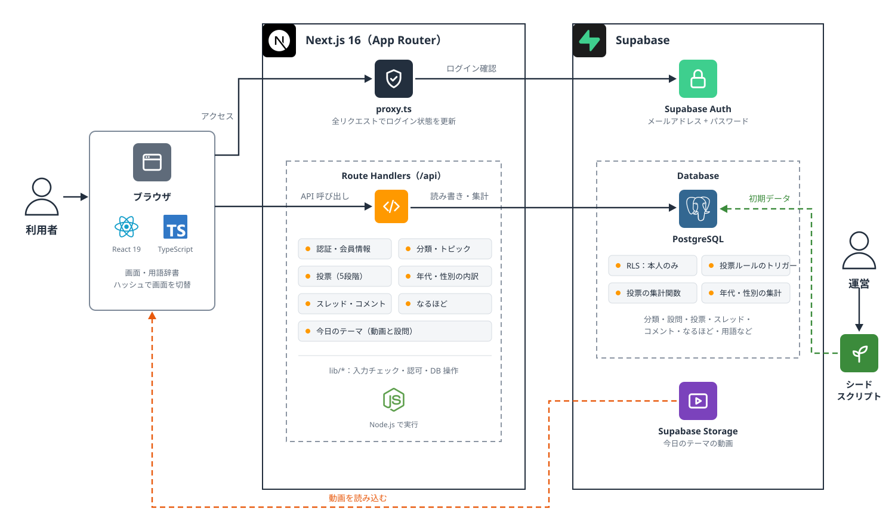
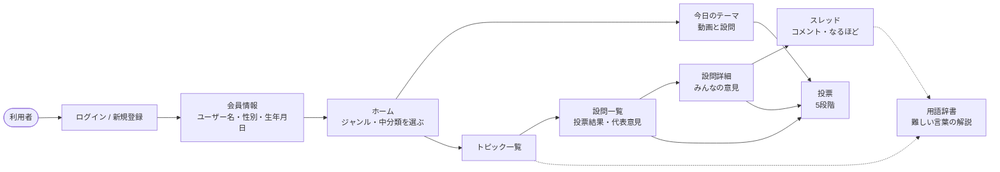
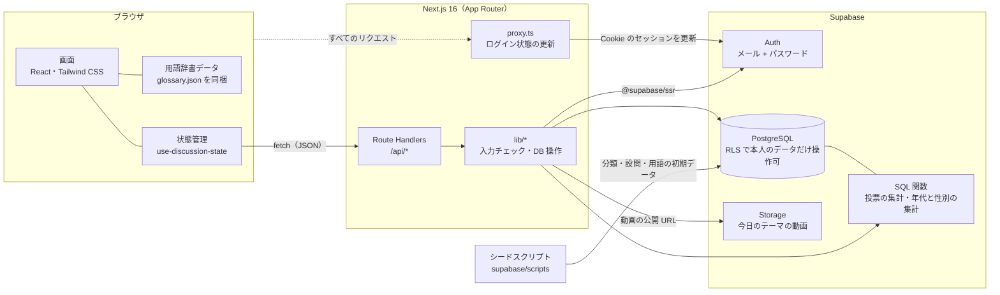
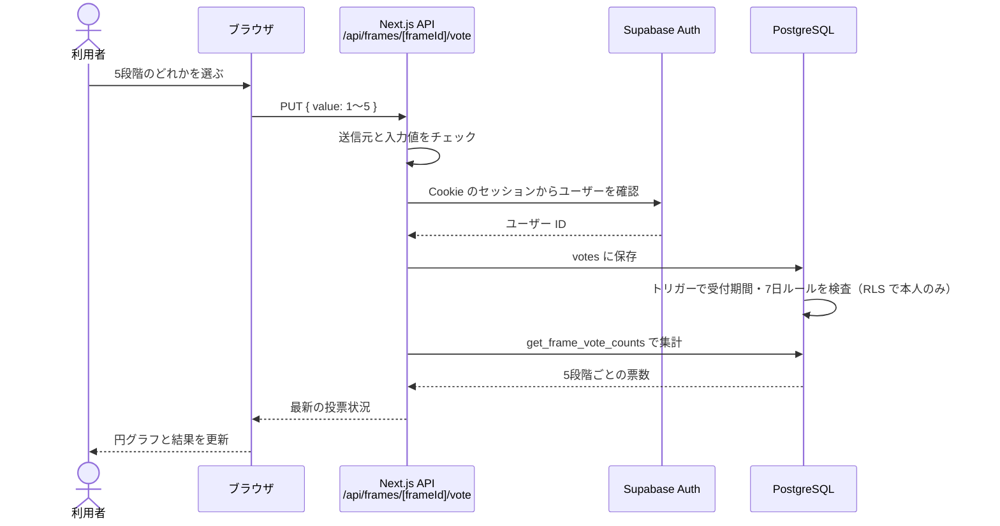
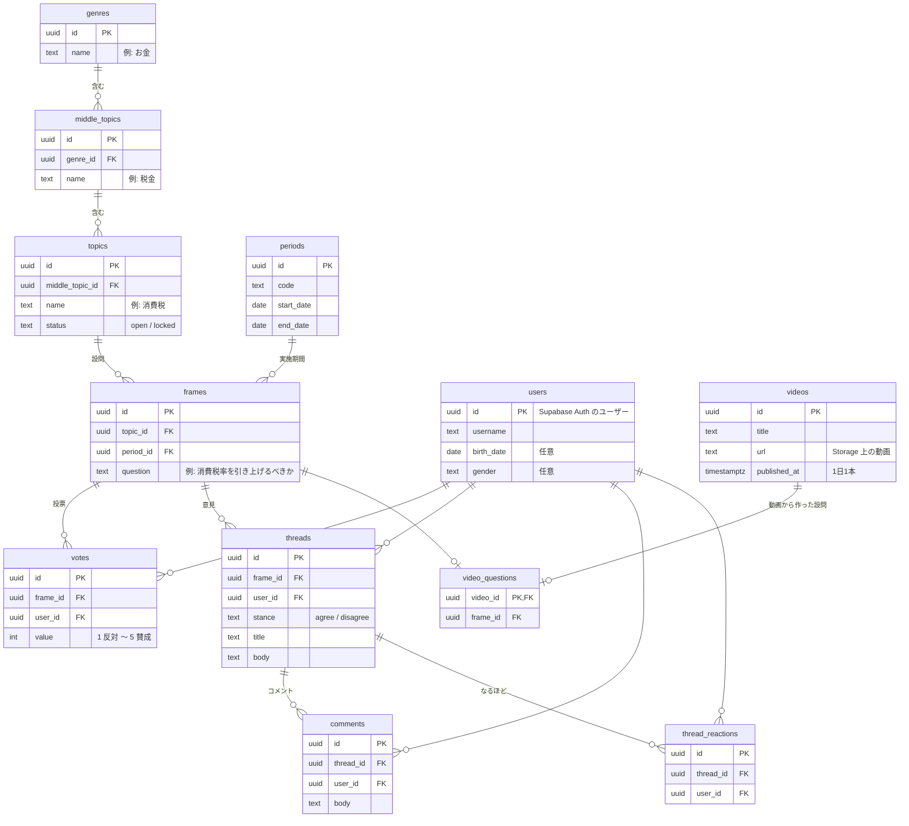

# アーキテクチャ

Rights のシステム構成と処理の流れ

- [1. アーキテクチャ図](#1-アーキテクチャ図)
- [2. 概要図（利用の流れ）](#2-概要図利用の流れ)
- [3. システム構成図](#3-システム構成図)
- [4. 処理の流れ（投票）](#4-処理の流れ投票)
- [5. データ構造](#5-データ構造)

## 1. アーキテクチャ図

## 2. 概要図（利用の流れ）

政治の話題を「ジャンル → 中分類 → トピック → 設問」の4段階で絞り込み、設問ごとに投票と意見交換を行う。

## 3. システム構成図

画面と API は Next.js の1つのアプリにまとめている。データと認証は Supabase に置き、ブラウザから Supabase へ直接は書き込まず、必ず Next.js の API を通す。

### API 一覧

| 区分 | エンドポイント | 内容 |
| --- | --- | --- |
| 認証 | `POST /api/auth/sign-up` `POST /api/auth/sign-in` `POST /api/auth/sign-out` `GET /api/auth/session` `GET /auth/confirm` | 新規登録・ログイン・ログアウト・ログイン状態の確認・確認メールのリンクからのログイン |
| 会員情報 | `GET` / `PATCH /api/profile` | ユーザー名・性別・生年月日の取得と更新 |
| 分類 | `GET /api/catalog` | ジャンル・中分類・トピックの一覧 |
| トピック | `GET /api/topics/[topicId]` | トピックの設問と投票状況 |
| 今日のテーマ | `GET /api/daily-theme` | 当日の動画と設問 |
| 投票 | `PUT /api/frames/[frameId]/vote` | 5段階で投票（変更は7日ごと） |
| 投票の内訳 | `GET /api/frames/[frameId]/demographics` | 投票者の年代・性別の構成 |
| スレッド | `GET` / `POST /api/frames/[frameId]/threads` `GET /api/threads/[threadId]` | 意見の一覧・投稿・詳細 |
| コメント | `POST /api/threads/[threadId]/comments` | スレッドへのコメント |
| なるほど | `PUT /api/threads/[threadId]/reaction` | 意見への「なるほど」の付け外し |

## 4. 処理の流れ（投票）

投票のルール（受付期間・7日間は変更不可）は DB のトリガーでも検査しており、API を経由しない書き込みでも破れないようにしている。

## 5. データ構造

主要なテーブルの関係を示す（作成日時などの共通の列は省略）。

